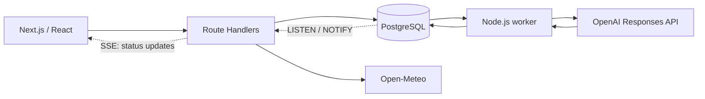

# Gloom

### Your wardrobe. Your weather. Your day.


Gloom helps you choose clothes from your own wardrobe for the weather in a selected city. Upload a photo of an item, review the AI-generated description, and get one to three outfits for the next three hours.

A pet project focused on **frontend engineering and GenAI integration**: SSR, client-side caching, a multimodal LLM, asynchronous jobs, and SSE-driven UI updates. The app runs locally and requires no sign-in.


_An actual screenshot of the demo mode. The clothes, weather, and outfits are prepared in advance; no external APIs are called._

## Features

| Scenario                   | What the app does                                                                                                                                           |
| -------------------------- | ----------------------------------------------------------------------------------------------------------------------------------------------------------- |
| Photo-based wardrobe       | Accepts JPEG, PNG, and WebP. AI can suggest an item type, layers, seasons, and an approximate comfortable temperature; you review and edit the description. |
| Weather-based outfits      | Considers feels-like temperature, wind, and precipitation over a fixed three-hour period. Recommends only items that exist in your wardrobe.                |
| Item replacement           | Checks an alternative for the same role and keeps the rest of the outfit. No additional LLM request is needed.                                              |
| State recovery             | Saves the latest outfit selection and restores jobs after a reload. Changes to the wardrobe or weather mark the result as outdated.                         |
| Weather-themed visuals     | Selects a background from nine original SVG illustrations. Shows a neutral background when the context is outdated.                                         |
| Languages                  | English by default, with Russian available as an option. Switching languages preserves forms, selected weather, results, and active jobs.                   |
| Demo without service setup | Explore a sample wardrobe and three weather scenarios without PostgreSQL or an OpenAI API key.                                                              |

AI is called only after an explicit user action. Uploading a photo, refreshing the weather, or replacing an item does not trigger generation on its own.

## Technology

| Area                        | Stack                                                                                            |
| --------------------------- | ------------------------------------------------------------------------------------------------ |
| Frontend                    | **Next.js 16**, App Router, React 19, TypeScript, Server Components, and SSR                     |
| Localization                | Typed en/ru dictionaries, cookie-based preference and SSR, `Intl`; no additional library         |
| Data and forms              | TanStack Query, React Hook Form, Zod                                                             |
| UI                          | Tailwind CSS 4, shadcn/ui, Radix UI, Lucide                                                      |
| Backend and storage         | Next.js Route Handlers, Node.js, PostgreSQL, Knex, Docker Compose                                |
| GenAI and external services | OpenAI Responses API: vision and Structured Outputs; Open-Meteo Forecast and Geocoding; ipapi.co |
| Image processing            | Sharp, JPEG normalization, EXIF removal, private file storage                                    |
| Testing and quality         | Vitest, Testing Library, Playwright, ESLint, Prettier                                            |
| Environment                 | Node.js 24, pnpm 12.11.2                                                                         |

## Engineering decisions

- **Server/client boundary.** Initial data is rendered with SSR; TanStack Query manages subsequent requests, caching, and UI mutations.
- **Validated LLM output.** Structured Outputs defines the response shape, while a domain validator checks real item IDs, roles, layers, and weather rules. Unverified rain protection is explicitly marked.
- **Jobs survive reloads.** A separate Node.js worker picks up operations from PostgreSQL. Status updates are delivered through `LISTEN/NOTIFY` and SSE, without periodic GET polling.
- **Paid request controls.** Idempotency prevents duplicate jobs; a shared monthly budget tracks spending and reserves in whole microUSD. An unknown outcome never triggers an automatic retry.
- **Localization without losing state.** SSR uses the selected language; switching does not remount forms or trigger generation. The AI response language is fixed when a job starts, and saved text is not translated automatically.
- **User data integrity.** AI suggestions are applied separately from manual edits. Version checks prevent outdated results from being published; photos are stored outside `public`.



## Verification

Stage 5a (i18n) checks, **October 16, 2026**:

| Check                            | Result                        |
| -------------------------------- | ----------------------------- |
| Unit, component, and integration | **472 tests** across 61 files |
| Desktop and mobile E2E           | **32 tests**                  |
| Line / branch coverage           | **97.85% / 90.69%**           |
| TypeScript, ESLint, Prettier     | Passed                        |
| Production build                 | Verified with Webpack         |

Integration tests use real PostgreSQL and file storage in an isolated environment. E2E tests replace the OpenAI transport while running the worker, ledger, and SSE end to end. A separate live OpenAI check with a synthetic wardrobe returned two outfits that passed server-side validation.

## Local setup

**Demo only:** Requires Node.js 24 and pnpm 12.11.2. Run `pnpm install --frozen-lockfile` and `pnpm dev`, then open [/demo](http://127.0.0.1:3000/demo). Docker, a database, and an API key are not required.

**Personal wardrobe and AI:** Start **Docker Desktop** as well. If you use nvm, select the Node version from `.nvmrc`.

```sh
nvm use
pnpm install --frozen-lockfile
cp -n .env.example .env.local
```

Configure `.env.local` for the personal wardrobe:

- `POSTGRES_PASSWORD` — a randomly generated password for the local database.
- `DATABASE_URL` — `postgresql://wardrobe:<password>@127.0.0.1:55432/wardrobe`; it must use the same password as `POSTGRES_PASSWORD`, URL-encoded.
- `ENABLE_AI=true` and `OPENAI_API_KEY` — required for recognition and outfit generation. With `ENABLE_AI=false`, you can use the wardrobe manually.

If the key is already set in `.env`, remove the empty `OPENAI_API_KEY=` line from `.env.local`; otherwise, it overrides the key. Secret files are excluded from Git.

**App** — first terminal:

```sh
pnpm db:up
pnpm db:migrate
NODE_USE_SYSTEM_CA=1 pnpm dev
```

**AI worker** — second terminal, from the project root:

```sh
NODE_USE_SYSTEM_CA=1 pnpm worker
```

**Pages:**

- [Wardrobe](http://127.0.0.1:3000/wardrobe) — upload, describe, and save clothing items.
- [Outfit selection](http://127.0.0.1:3000/outfits) — choose a city and manually start outfit generation.
- [Demo](http://127.0.0.1:3000/demo) — prepared examples without a database or OpenAI.

`NODE_USE_SYSTEM_CA=1` is used on the current Mac so Node trusts the system certificates. Restart the app and worker after changing environment variables. The app's AI admission limit is **$10 per month**; it does not limit spending by other applications in your OpenAI account.

## Stopping and testing

Stop the app and worker with `Ctrl+C`; stop the database with `pnpm db:stop`. Database data and photos in `.data/photos` are preserved.

```sh
pnpm test
pnpm lint
pnpm typecheck
pnpm test:coverage # requires a running database
```

For more details, production builds, and E2E tests, see [docs/DEVELOPMENT.md](docs/DEVELOPMENT.md).

## Status and documentation

The wardrobe, recognition, weather, outfit selection, item replacement, weather backgrounds, and **i18n (English by default, with Russian available in the header)** are implemented. The language preference persists after reload, and URLs remain unchanged. **The next stage is a context-aware streaming chat**, which has not been implemented yet.

- [Project idea and requirements](docs/PROJECT.md)
- [Architecture and implementation plan](docs/IMPLEMENTATION_PLAN.md)
- [Development, checks, and limitations](docs/DEVELOPMENT.md)
