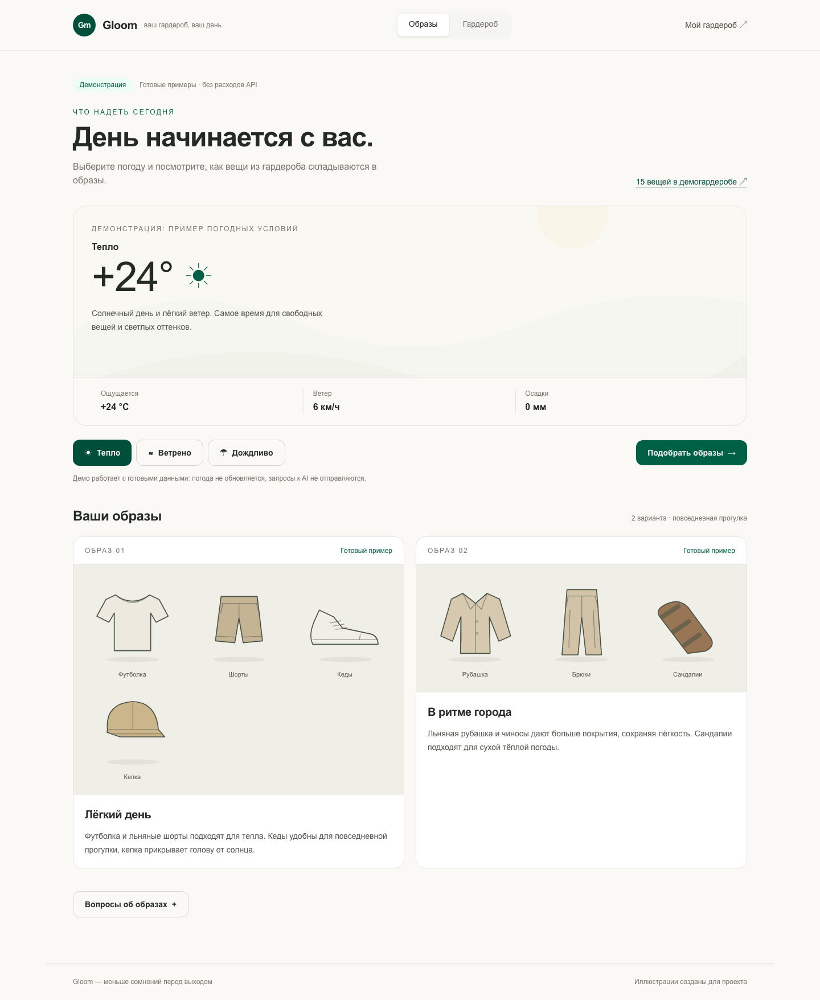
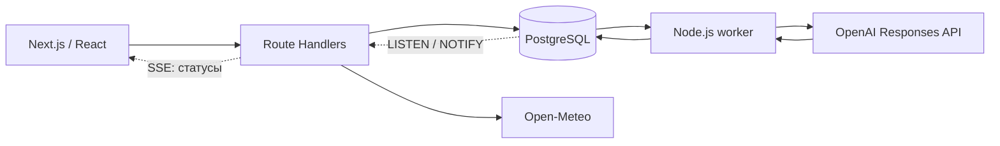

# Gloom

### Ваш гардероб. Ваша погода. Ваш день.


Gloom помогает выбрать одежду из собственного гардероба под погоду в выбранном городе. Загрузите фотографию вещи, проверьте предложенное AI-описание и получите от одного до трёх образов на ближайшие три часа.

Pet project с фокусом на **frontend engineering и интеграцию GenAI**: SSR, клиентский кеш, мультимодальная LLM, асинхронные задачи и обновления интерфейса через SSE. Приложение запускается локально, без регистрации.



*Реальный скриншот деморежима. Вещи, погода и образы здесь подготовлены заранее; внешние API не вызываются.*

## Возможности

| Сценарий | Что делает приложение |
| --- | --- |
| Гардероб по фотографиям | Принимает JPEG, PNG и WebP. AI предлагает тип, слои, сезонность и ориентировочную температуру; пользователь проверяет и исправляет описание. |
| Образы под погоду | Учитывает ощущаемую температуру, ветер и осадки за фиксированные три часа. Предлагает только существующие вещи из гардероба. |
| Замена вещей | Проверяет альтернативу той же роли и сохраняет остальные вещи в образе. Повторный запрос к LLM не требуется. |
| Восстановление состояния | Сохраняет последний подбор и восстанавливает задачу после перезагрузки. Изменение гардероба или погоды отмечает результат как устаревший. |
| Погодное оформление | Выбирает фон из девяти собственных SVG-иллюстраций. При устаревании контекста показывает нейтральный фон. |
| Демо без настройки сервисов | Позволяет посмотреть готовый гардероб и три погодных сценария без PostgreSQL и ключа OpenAI. |

AI вызывается только по явному действию. Загрузка фотографии, обновление погоды и замена вещи сами по себе не запускают генерацию.

## Технологии

| Область | Стек |
| --- | --- |
| Frontend | **Next.js 16**, App Router, React 19, TypeScript, Server Components и SSR |
| Данные и формы | TanStack Query, React Hook Form, Zod |
| Интерфейс | Tailwind CSS 4, shadcn/ui, Radix UI, Lucide |
| Backend и хранение | Next.js Route Handlers, Node.js, PostgreSQL, Knex, Docker Compose |
| GenAI и внешние сервисы | OpenAI Responses API: vision и Structured Outputs; Open-Meteo Forecast и Geocoding; ipapi.co |
| Работа с изображениями | Sharp, нормализация JPEG, удаление EXIF, приватное файловое хранилище |
| Тестирование и качество | Vitest, Testing Library, Playwright, ESLint, Prettier |
| Окружение | Node.js 24, pnpm 12.11.2 |

## Инженерные решения

- **Граница сервера и клиента.** Начальные данные приходят через SSR; TanStack Query управляет последующими запросами, кешем и мутациями интерфейса.
- **Проверяемый результат LLM.** Structured Outputs задаёт форму ответа, а доменный валидатор проверяет реальные ID вещей, роли, слои и погодные правила. Неподтверждённая защита от дождя явно отмечается.
- **Задачи переживают перезагрузку.** Отдельный Node.js worker получает операции из PostgreSQL. Статусы доставляются через `LISTEN/NOTIFY` и SSE без периодического GET-поллинга.
- **Контроль платных запросов.** Идемпотентность защищает от дублей; общий месячный бюджет учитывает расходы и резервы в целых microUSD. Неопределённый исход не вызывает автоматический повтор запроса.
- **Сохранность пользовательских данных.** AI-предложение применяется отдельно от ручных правок. Версии данных защищают от публикации устаревшего результата; фотографии хранятся вне `public`.



## Проверки

Последний зафиксированный прогон — **16 октября 2026 года**:

| Проверка | Результат |
| --- | --- |
| Unit, component и integration | **414 тестов** |
| E2E на desktop и mobile | **24 проверки** |
| Покрытие строк / ветвей | **97,83% / 91,25%** |
| TypeScript, ESLint, Prettier | Пройдены |
| Production-сборка | Проверена с Webpack |

Интеграционные тесты используют настоящие PostgreSQL и файловое хранилище в изолированном окружении. В E2E транспорт OpenAI подменяется, а worker, ledger и SSE работают полностью. Отдельная живая проверка OpenAI на синтетическом гардеробе вернула два образа, прошедших серверную валидацию.

## Локальный запуск

**Только демо:** нужны Node.js 24 и pnpm 12.11.2. Выполните `pnpm install --frozen-lockfile` и `pnpm dev`, затем откройте [/demo](http://127.0.0.1:3000/demo). Docker, БД и API-ключ не нужны.

**Личный гардероб и AI:** дополнительно запустите **Docker Desktop**. При использовании nvm версия Node выбирается из `.nvmrc`.

```sh
nvm use
pnpm install --frozen-lockfile
cp -n .env.example .env.local
```

Для личного гардероба заполните `.env.local`:

- `POSTGRES_PASSWORD` — случайный пароль для локальной БД.
- `DATABASE_URL` — `postgresql://wardrobe:<пароль>@127.0.0.1:55432/wardrobe`; пароль должен совпадать с `POSTGRES_PASSWORD` и быть URL-encoded.
- `ENABLE_AI=true` и `OPENAI_API_KEY` — для распознавания и подбора. С `ENABLE_AI=false` доступен ручной гардероб.

Если ключ уже задан в `.env`, удалите пустую строку `OPENAI_API_KEY=` из `.env.local`: она перекрывает ключ. Файлы с секретами исключены из Git.

**Приложение** — первый терминал:

```sh
pnpm db:up
pnpm db:migrate
NODE_USE_SYSTEM_CA=1 pnpm dev
```

**AI-worker** — второй терминал из корня проекта:

```sh
NODE_USE_SYSTEM_CA=1 pnpm worker
```

**Страницы:**

- [Гардероб](http://127.0.0.1:3000/wardrobe) — загрузка, описание и сохранение вещей.
- [Подбор образов](http://127.0.0.1:3000/outfits) — выбор города и ручной запуск подбора.
- [Демо](http://127.0.0.1:3000/demo) — готовые примеры без БД и OpenAI.

`NODE_USE_SYSTEM_CA=1` используется на текущем Mac для доверия системным сертификатам. После изменения env перезапустите приложение и worker. Лимит допуска AI-запросов приложения — **$10 в месяц**; он не ограничивает расходы других приложений в аккаунте OpenAI.

## Остановка и проверки

Приложение и worker останавливаются через `Ctrl+C`, БД — командой `pnpm db:stop`. Данные БД и фотографии в `.data/photos` сохраняются.

```sh
pnpm test
pnpm lint
pnpm typecheck
pnpm test:coverage # требует запущенной БД
```

Подробности, production-сборка и E2E: [docs/DEVELOPMENT.md](docs/DEVELOPMENT.md).

## Статус и документация

Реализованы гардероб, распознавание, погода, подбор, замена вещей и погодные фоны. **Контекстный чат с потоковыми ответами — следующий этап, пока не реализован.**

- [Идея и требования](docs/PROJECT.md)
- [Архитектура и план реализации](docs/IMPLEMENTATION_PLAN.md)
- [Разработка, проверки и ограничения](docs/DEVELOPMENT.md)
