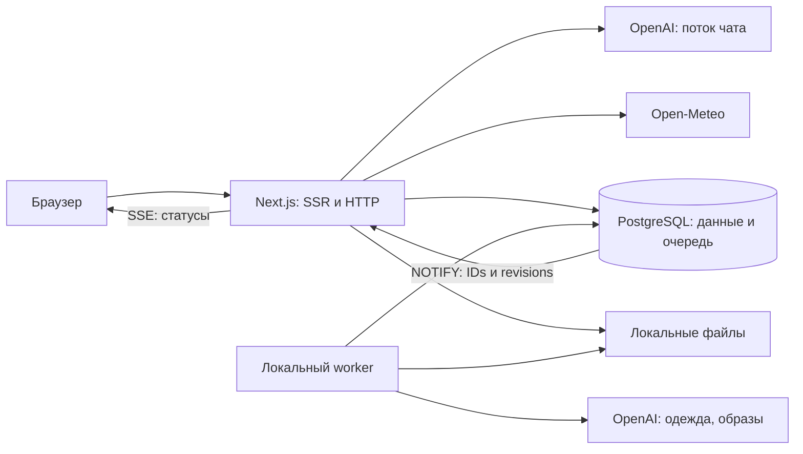

# Технический план: «Одежда под погоду», версия 1

Дата: 12 октября 2026 года. Обновлено: 16 октября 2026 года.
Статус: принятый технический baseline, уточнённый 12 октября: SSE для статусов и готовый каталог фонов. Этапы описывают последовательность работы, не отдельные повторные разрешения.

Основание — [PROJECT.md](PROJECT.md). Scope уточнён только заменой runtime-генерации фона и транспорта статусов; новых функций не добавлено. Остальные библиотеки, worker и численные параметры приняты. Доступность моделей, цены, версии и API проверяются при реализации. Этапы 0–5 завершены; этапы 6–7 ещё не реализованы. Результаты и запуск — в [DEVELOPMENT.md](DEVELOPMENT.md).

## 1. Результат и неизменные условия

В первой версии локальное приложение сохраняет гардероб, получает погоду, по ручному запуску подбирает 1–3 образа и выбирает погодный фон из 8–16 заранее подготовленных изображений. Дополнительное окно объясняет погоду и одежду в диалоге с реальным стримингом. Демо работает на готовых данных без OpenAI.

Для каждого сценария сохраняются следующие условия:

- Один локальный гардероб без аккаунтов; приложение и PostgreSQL доступны только на этом компьютере.
- Фотография и утверждённые характеристики переживают перезапуск. Исправления пользователя имеют приоритет.
- SSR, открытие окна чата, обновление погоды и смена города не запускают платные операции.
- Образы содержат только существующие вещи и проходят серверные проверки. Текст чата не становится проверенным образом.
- Подбор фиксирует один интервал «момент запуска + 3 часа», погоду и версии исходных данных.
- Хранится только последний успешный результат. Неудачная новая попытка его не стирает.
- Фон связан с успешным ручным подбором и его snapshot, сохраняется как `backgroundPresetId` и не задерживает образы. Каталог не обращается к AI и не создаёт задач worker.
- Повторная отправка одного действия не создаёт второй платный запрос. Таймаут не означает отсутствие расходов.
- Общий месячный лимит $10 и предупреждение $8 относятся к распознаванию, подбору и чату, включая разработку/тесты; учитываются завершённые расходы, активные резервы и операции с неизвестной стоимостью.
- Чат только объясняет и советует; не изменяет гардероб, город, результат и не запускает генерации.
- Пользователи, хостинг, история образов, виртуальная примерка и персонализация не добавляются.

## 2. Технический baseline

Принятые решения: Next.js App Router, React, TypeScript, SSR, Tailwind CSS, shadcn/ui, TanStack Query; PostgreSQL через Docker Compose, Knex; локальная папка фотографий; OpenAI; Open-Meteo Forecast и Geocoding. SSE выбран для уведомлений о статусах и отдельного потока чата.

Основной пакетный менеджер — **pnpm**. Текущий baseline `12.11.2` закреплён в `packageManager`, зависимости — в `pnpm-lock.yaml`; установка и скрипты выполняются через pnpm.

Дополнительные библиотеки и инструменты приняты; конкретные версии проверяются перед установкой:

| Библиотека/инструмент | Назначение |
| --- | --- |
| `pg` | Драйвер PostgreSQL для Knex |
| `zod` | Схемы пользовательского ввода, внешних ответов и результатов AI |
| `react-hook-form`, `@hookform/resolvers` | Редактируемая карточка, ошибки и связь формы со схемой |
| `openai` | Официальный серверный SDK, структурированные ответы и поток чата |
| `sharp` | Валидация и нормализация фотографий без EXIF, создание уменьшенной AI-копии |
| Vitest, Testing Library, Playwright | Unit/component, integration и E2E-проверки |

HTTP-запросы к погодным сервисам выполняются через встроенный `fetch`; форматирование времени — через `Intl`. Отдельный глобальный state manager и AI-оркестратор для первой версии не нужны. Точные версии Node.js и пакетов фиксируются перед созданием приложения после проверки совместимости, вместе с lockfile; обновление существующего окружения ECC не входит в работу.

Стартовая модель `gpt-6-luna` для распознавания, подбора и чата проверяется на доступность, поддерживаемые возможности и стоимость до платной интеграции. Неподтверждённый идентификатор не переносится в рабочую конфигурацию молча; корректировка документируется. Модели генерации изображений в baseline нет.

## 3. Архитектура и границы модулей

Принят модульный монолит: Next.js в Node.js runtime и небольшой worker из того же TypeScript-проекта как отдельный локальный процесс. PostgreSQL хранит данные и очередь операций; Redis и дополнительный backend не требуются.

Worker обеспечивает продолжение распознавания и подбора после закрытия браузера и исключает запуск через необслуживаемый promise после HTTP-ответа. Он также выполняет идемпотентную очистку пользовательских фотографий/черновиков. Только распознавание и подбор являются его AI-задачами. Чат обслуживается напрямую потоковым HTTP-запросом: его история существует только в памяти текущей вкладки. Worker вводится вместе с первой AI-операцией ради долговечности этих двух сценариев.



```text
src/app/                       страницы, layout, Route Handlers
src/features/wardrobe/         схемы, карточки, хранение, загрузка
src/features/location/         выбранный город, поиск, IP-кандидат
src/features/weather/          адаптер Open-Meteo, кеш, интервалы
src/features/outfits/          подбор, валидатор, замена, актуальность
src/features/backgrounds/      manifest каталога, weather-code mapping и оформление
src/features/chat/             контекст, поток, окно и состояние диалога
src/features/demo/             неизменяемые фикстуры и готовые ответы
src/server/ai/                 SDK-адаптеры и преобразование ответов
src/server/operations/         бюджет, ledger, очередь, идемпотентность
src/server/db/                 Knex и транзакции
src/server/files/              безопасные ключи, запись, выдача, удаление
src/components/ui/             добавленные компоненты shadcn/ui
src/worker/                    входная точка и обработчики очереди
db/migrations/                 версионируемые изменения PostgreSQL
public/weather-backgrounds/    8–16 готовых публичных иллюстраций каталога
tests/integration/             PostgreSQL, файлы, HTTP и имитация провайдеров
tests/e2e/                     пользовательские сценарии
```

Доменная логика не зависит от React и HTTP. Серверные сервисы вызывают репозитории и адаптеры; [Route Handlers](https://nextjs.org/docs/app/getting-started/route-handlers) и [Server Components](https://nextjs.org/docs/app/getting-started/server-and-client-components) используют одни и те же сервисы. Next.js не обращается к собственному HTTP API ради SSR, согласно [рекомендациям Next.js](https://nextjs.org/docs/app/guides/production-checklist). SDK, Knex, пути файлов и секреты не попадают в клиентскую сборку.

### SSR и клиент

- Server Components загружают сохранённый город, гардероб, бюджет, последний результат и восстанавливаемые черновики с активными операциями. Их ID передаются клиенту, чтобы после reload продолжить чтение статуса без повторного запуска AI. Погода подгружается отдельно с локальным состоянием ожидания; её отказ не скрывает гардероб.
- Персональные ответы не включаются в общий кеш Next.js и не отдаются как публично кешируемые. Публичный кеш погоды и геопоиска отделён от гардероба.
- Клиент отвечает за превью, форму, диалоги, поиск, кнопки, отслеживание задач и поток чата.
- TanStack Query получает начальные SSR-данные со временем актуальности. Серверный QueryClient, если потребуется prefetch/hydration, создаётся на запрос, а не как общий singleton. Ключи включают режим и необходимые идентификаторы; не выполняется немедленная повторная загрузка только из-за гидратации. Основание — [документация SSR TanStack Query](https://tanstack.com/query/latest/docs/framework/react/guides/advanced-ssr).
- После изменения используется подтверждённый сервером результат и точечное обновление/инвалидация кеша. Обязательные двойные загрузки через `router.refresh` и Query не закладываются.
- Один EventSource-feed на вкладку принимает статусы наблюдаемых операций и обновляет Query cache по operation ID/revision. Начальные snapshots включают завершившиеся операции; periodic client refetch статусов не используется.
- Чат имеет отдельный контроллер `fetch`/ReadableStream/AbortController для POST-SSE. Query не накапливает поток и не возобновляет платную операцию при reconnect.

## 4. Данные PostgreSQL и локальные файлы

Ниже — принятый минимальный состав таблиц; точные поля миграций проверяются при реализации. Справочники категорий и допустимые значения хранятся в версионируемых схемах приложения, без административного интерфейса.

| Таблица | Основные данные и ограничения |
| --- | --- |
| `app_state` | Одна строка: выбранное место, координаты, timezone, источник; `location_version`, `wardrobe_version` |
| `garments` | UUID, утверждённые поля карточки, `photo_id`, `version`, timestamps; удалённые вещи исключены из чтения |
| `photo_assets` | UUID, серверный относительный ключ, проверенные размеры/формат, состояние `draft/attached/delete_pending`, срок черновика |
| `garment_drafts` | Фото, AI-предложение или ручные поля, срок жизни и связь с операцией; не входят в гардероб до сохранения |
| `outfit_result` | Одна текущая запись: revision, интервал UTC/timezone, snapshot погоды/характеристик, версии города/гардероба, 1–3 комплекта, предупреждения, `backgroundPresetId` из manifest |
| `weather_cache` | Координаты/параметры, ответ, `fetched_at`, срок актуальности; только публичные погодные данные |
| `geocoding_cache` | Нормализованный запрос/язык/параметры, проверенные результаты, срок актуальности |
| `ai_operations` | Тип, idempotency key/hash, статус, монотонная `status_revision`, snapshot/payload, deadline, lease, попытка, `dispatch_at`, состояние отправки `not_sent/sent_unknown/response_received`, request ID, ссылка на результат/ошибку |
| `ai_cost_ledger` | Операция, месяц UTC, pricing revision, модель, резерв, подтверждённый расход, состояние расчёта |
| `ai_budget_months` | Уникальный месяц UTC, лимит, `confirmed_cost`, `active_reserved`, `unknown_reserved`; строка блокируется при допуске/settlement, суммы согласованы с ledger |

Для nullable/JSONB-полей действуют схемы и ограничения БД; JSON не заменяет проверку инвариантов. AI draft и утверждённая карточка имеют отдельные схемы: неизвестные свойства сохраняются, пользовательские правки не теряются. Образы хранят ссылки на вещи, их выбранные роли и snapshot характеристик без копий фотографий. Snapshot относится только к текущему результату и активной операции, а не создаёт галерею истории. Payload результата задачи очищается после публикации; ограниченный retention технических snapshot не создаёт архив комплектов. Ledger хранит учёт, не историю чата. Для chat-операций сохраняются только audit metadata, hash, usage и IDs; тело сообщений не попадает в `ai_operations`.

Изменение/удаление вещи увеличивает `wardrobe_version` в той же транзакции. Выбор города увеличивает `location_version`. Актуальность результата вычисляется из версий и конца периода при чтении, а не из отдельного фонового таймера. Обновление подтверждённой погоды может менять статус результата по согласованным правилам исходных данных; открытие страницы не сдвигает сохранённый период.

Изменения карточек и замены используют optimistic concurrency: клиент передаёт ожидаемую revision/version; конфликт возвращает `409` и требует обновить данные. При завершении подбора повторно проверяются версии snapshot, revision текущего результата и приоритет запуска: более старая операция не может заменить результат более новой или стереть выполненную замену. Результат из изменившегося гардероба не публикуется как актуальный; прежний успешный результат сохраняется. Запоздалое распознавание изменяет только существующий неутверждённый черновик, не перезаписывает сохранённую карточку и не восстанавливает удалённую вещь.

### Файлы, черновики и удаление

1. Сервер ограничивает поток загрузки 10 МБ до декодирования; проверяет содержимое, формат, отсутствие анимации, лимит 40 МП и сторону 8192 px. Ограничение декодируемых пикселей задаётся явно в [sharp](https://sharp.pixelplumbing.com/api-constructor/), уменьшение выходного файла само по себе не ограничивает память входа.
2. После нормализации создаёт фото до 2048 px без метаданных и AI-копию до 1536 px, не увеличивая маленькие изображения.
3. Записывает файл через временное имя в постоянной папке и переименование; сохраняет asset/draft в БД. Оригинал с EXIF не сохраняется.
4. Сохранение карточки в одной транзакции связывает готовый asset с новой вещью и увеличивает версию гардероба. После ошибки можно повторить сохранение без распознавания.
5. Отказ от черновика/истечение срока ставит ненужные assets на очистку. Принятый срок черновика — 24 часа; срок не удаляет уже прикреплённое фото.
6. Удаление сначала исключает вещь из использования и ставит `delete_pending`, затем удаляет файл. Неудача сохраняет понятный статус и поддерживает повтор. Очистка идемпотентна; уже отсутствующий файл считается удалённым.
7. Ошибка записи БД после создания файла запускает компенсирующую очистку. Для падения процесса в этом окне нужна сверка управляемой папки с БД: удаляются только осиротевшие фотографии старше защитного срока, после повторной проверки отсутствия связи с asset, черновиком или активной операцией. Свежие и используемые файлы пропускаются; правило действует также для незавершённых временных файлов внутри управляемой папки фотографий.

Папка пользовательских фото `data/photos` расположена вне `public`/сборки/временных файлов, исключается из Git. Браузер получает asset UUID, не имя исходника и не полный путь. Выдача через сервер разрешает только известный ключ внутри заданного корня; произвольный путь из HTTP не принимается. Проверяется и жизненный статус: `delete_pending`, фото удалённых вещей и истёкших черновиков недоступны даже по прямому URL, пока физическая очистка ещё не завершена. Отсутствие файла отображается отдельно от отсутствия вещи. Публичные bundled-иллюстрации фонов находятся отдельно и не участвуют в динамической очистке/backup личных данных.

Согласованная резервная копия — `pg_dump` и соответствующие assets с временно приостановленной записью приложения/worker. Достаточно документированного локального runbook; интерфейс экспорта не добавляется.

## 5. Baseline HTTP-контрактов

Все обычные ответы используют envelope `success/data/error/meta`, при списках — metadata. Ошибка содержит стабильный code, понятное сообщение и безопасные детали полей; SQL, пути и ответы провайдера не раскрываются. Потоки статусов/чата и бинарная выдача фото — явные исключения: SSE-протокол и корректный image response соответственно. Public API versioning framework не требуется.

| Метод и путь | Результат |
| --- | --- |
| `GET /api/garments` | Гардероб и версия |
| `POST /api/garment-drafts` | Проверка/нормализация multipart-фото; черновик без AI |
| `POST /api/garment-drafts/:id/recognition` | Явный запуск распознавания; `202` и operation ID |
| `GET /api/garment-drafts/:id` | Фото, состояние и редактируемое предложение |
| `POST /api/garments` | Сохранение утверждённой карточки из черновика, `201` |
| `PATCH /api/garments/:id` | Сохранение полей с ожидаемой version |
| `DELETE /api/garments/:id` | Исключение вещи и статус удаления файла; повтор допускается |
| `GET /api/assets/:id` | Контролируемая выдача пользовательского фото, корректный content type |
| `GET /api/locations/search?q=…` | Проверенные результаты поиска с регионом и страной |
| `PUT /api/location` | Сохранение проверенного выбранного места, source и version |
| `GET /api/weather` | Погода сохранённого города, период и fetchedAt, статус актуальности |
| `POST /api/outfit-selections` | Ручной запуск, `202`; фиксирует интервал и snapshot |
| `GET /api/outfit-result` | Только последний результат, revision и причины устаревания |
| `GET /api/outfit-result/:outfitId/alternatives?slot=…` | Проверенные кандидаты замены без AI |
| `PATCH /api/outfit-result/:outfitId/slots/:slot` | Замена с ожидаемой revision и проверкой всего комплекта |
| `GET /api/operations/:id` | Разовое чтение/диагностика статуса; без интервала повторов, никогда не запускает AI |
| `GET /api/operation-events?ids=…` | Один SSE-feed на вкладку: snapshot всех запрошенных ID, затем изменения с operationId/status_revision |
| `GET /api/ai-budget` | Расход, резервы, доступный остаток, предупреждение |
| `POST /api/chat/responses` | Поток Q&A; только явная отправка сообщения |

`400/422` обозначают некорректный ввод, `404` — отсутствие ресурса, `409` — конфликт версии/действия, `413/415` — файл, `429` — частоту/конкуренцию, `503` — недоступность сервиса. Недостаток бюджета имеет отдельный code, например `AI_BUDGET_EXCEEDED`, с предсказуемым клиентским состоянием.

Одна попытка платного действия получает UUID idempotency key в заголовке; сервер связывает его с типом, целевым ресурсом и hash проверенного payload. Тот же ключ с иным payload возвращает конфликт. Сохранение карточки тоже защищается от дублирующего submit. Мутации требуют допустимый Origin; приложение и порт БД привязаны к loopback. Ограничения частоты/размеров проверяются до дорогой работы; SQL параметризован через Knex.

### 5.1. Почему SSE

Для статусов нужен поток от сервера к клиенту; команды остаются обычными HTTP-запросами. Поэтому выбран SSE, а двусторонний транспорт не вводится.

| Вариант | Преимущества | Ограничения и оценка для проекта |
| --- | --- | --- |
| SSE | Текстовые события по HTTP, server push, native EventSource восстанавливает соединение | Односторонний поток и длительное HTTP-соединение; при HTTP/1.1 небольшой лимит соединений. Используем один feed статусов на вкладку, без отдельного соединения на задачу. [MDN SSE](https://developer.mozilla.org/en-US/docs/Web/API/Server-sent_events/Using_server-sent_events) |
| WebSocket | Двусторонний обмен, текст и binary; полезен для постоянного realtime-ввода | Для наших HTTP-команд добавляет протокол соединения, upgrade, heartbeat и собственный reconnect. Потребности в двустороннем потоке нет. [MDN WebSocket](https://developer.mozilla.org/en-US/docs/Web/API/WebSockets_API) |

Native EventSource используется только для read-only GET-feed статусов; его безопасный reconnect читает существующие операции. Чат отправляет тело через отдельный POST/fetch-SSE и не возобновляет платный запрос автоматически.

### 5.2. Доставка и восстановление статусов

- `GET /api/operation-events?ids=…` валидирует ограниченное множество operation ID. SSR передаёт ID восстанавливаемых задач. Один feed на вкладку сразу отдаёт snapshot всех запрошенных ID, включая задачи, завершившиеся до подписки, затем обновления.
- Каждая запись `ai_operations` имеет монотонную `status_revision`. Worker, Route Handler и recovery увеличивают её в транзакции любого изменения статуса и вызывают `pg_notify` в той же транзакции. PostgreSQL доставляет уведомление после commit; payload содержит только IDs/revisions, а источником истины остаётся БД. [PostgreSQL NOTIFY](https://www.postgresql.org/docs/current/sql-notify.html)
- На процесс Next.js используется выделенный `pg.Client` для `LISTEN`; соединение не возвращается в транзакционный пул Knex. Сначала регистрируется обработчик, затем выполняется LISTEN и его commit, затем читается snapshot. Уведомления на время чтения буферизуются; после снимка применяются только новые revisions. Такой порядок учитывает гонку начальной подписки. [PostgreSQL LISTEN](https://www.postgresql.org/docs/current/sql-listen.html)
- Feed подписывается на локальный обработчик до чтения snapshot. Клиент сравнивает revision отдельно для каждого operationId и игнорирует дубли/старые события; общего порядка между разными операциями не предполагается.
- После обрыва read-only feed подключается снова и получает актуальные snapshots, включая terminal состояния. Они заменяют пропущенные уведомления; `Last-Event-ID` не обещает полного replay. Durable event journal не добавляется, обращения к провайдеру не повторяются.
- Ошибка PG-listener помечает канал недоступным и закрывает/завершает feed для безопасного reconnect. Keepalive не маскирует потерю актуальности. После восстановления listener повторяется порядок handler → LISTEN commit → snapshots всех открытых/восстанавливаемых подписок до продолжения доставки обновлений.
- Ответ `text/event-stream` не буферизуется, служебные keepalive поддерживают соединение. AbortSignal освобождает подписки/таймеры; terminal состояние всех наблюдаемых задач или отсутствие watchers вызывает клиентский `EventSource.close()`. Dedicated connection закрывается при завершении процесса/HMR и не создаёт копящихся listeners.
- Разовый `GET /api/operations/:id` остаётся для диагностики или явного чтения. Доставка событий не выполняет периодических чтений статуса ни в браузере, ни в скрытом серверном таймере.

## 6. AI-операции, worker и бюджет

### Надёжный запуск

- Сервер сначала проверяет вход, состояние, версии и необходимые данные. Недопустимое фото, пустой гардероб или устаревшая/неполная погода не расходуют AI.
- В транзакции создаёт/возвращает уникальную операцию, блокирует строку месячного бюджета, проверяет и резервирует консервативную стоимость. Запись задачи и резерва выполняется вместе.
- Инвариант допуска под блокировкой `ai_budget_months`: `confirmed_cost + active_reserved + unknown_reserved + new_reserve ≤ month_limit`. Перенос резерва в confirmed/unknown или его безопасное освобождение обновляет counters и ledger одной транзакцией; неизвестный резерв не считается свободным остатком.
- Worker атомарно выбирает только queued-операции распознавания и подбора с lease и блокировкой PostgreSQL (`FOR UPDATE SKIP LOCKED`, [документация](https://www.postgresql.org/docs/current/sql-select.html)). До обращения к провайдеру фиксирует `dispatch_at` и переход `not_sent → sent_unknown`; подтверждённый ответ меняет состояние на `response_received`. Другой worker не повторяет потенциально отправленную операцию. Чат исполняется Route Handler и никогда не диспетчеризуется worker; обнаружение его просроченного состояния только сохраняет неопределённый учёт.
- Перед dispatch повторно проверяются deadline, наличие черновика/вещей и пригодность snapshot. Просроченная или ставшая неактуальной queued-операция завершается до провайдера с освобождением резерва; период не сдвигается автоматически.
- Статусы: `queued → running → succeeded | failed | timed_out | interrupted`. Отдельный settlement status: `reserved/confirmed/unknown/released`.
- Возвращённый результат валидируется и публикуется транзакционно. Статус готовности означает подтверждённый результат, а не только HTTP 200 от провайдера.
- Падение worker до dispatch допускает безопасное повторное получение задачи. После dispatch автоматический повтор запрещён: lease recovery отмечает исход неопределённым, резерв сохраняется.
- SSE-feed доставляет снимки и изменения статуса без периодических браузерных GET. Refresh восстанавливает подписку на существующие ID; reconnect не создаёт AI-операцию. Внутреннее получение worker-очереди и cleanup могут использовать периодическую проверку БД; доставка статусов не маскируется серверным таймером чтения.
- Для платных SDK-запросов отключаются собственные автоматические повторы (`maxRetries: 0`); на клиенте — mutation retries/offline replay. Дубли дополнительно защищаются сервером. Вложенные механизмы повторов учитываются по [документации OpenAI](https://developers.openai.com/api/docs/guides/rate-limits).

На старте один worker-процесс обслуживает распознавание и подбор и выполняет безопасную очистку фотографий. Отдельные слоты декора, приоритеты image-задач и универсальный job framework не нужны. Один активный подбор возвращает существующую операцию/конфликт при повторном запуске, а не второй платный запрос. Deadlines распознавания/подбора — 30/30 секунд из PROJECT.md. Поля lease обнаруживают зависшие задачи, но не доказывают, что провайдер ничего не выполнил.

### Учёт стоимости

- Цены и параметры модели фиксируются как серверная конфигурация с датой проверки. Резерв рассчитывается по ограниченным input/output tokens и стоимости входного изображения при распознавании, с запасом; точная формула проверяется по действующему API. Каталог фонов не резервирует расходы.
- Месячный ключ бюджета — UTC календарный месяц допуска операции; суммы хранятся в целых USD-микроединицах без float-округления. Это принятый технический baseline.
- При завершении резерв заменяется подтверждённым расходом по usage и pricing revision. Ошибка до dispatch освобождает резерв.
- Таймаут, обрыв и abort после dispatch при неизвестном usage оставляют консервативный резерв. Сверка через данные провайдера/диагностическую команду не запускает повтор AI и не притворяется точным расчётом.
- Строка бюджета блокируется транзакционно для конкурентных запусков. Завершение после полуночи не переносит допущенную операцию в другой месяц; поздние расходы относятся к месяцу допуска, смена месяца не теряет незавершённые резервы.
- $8 вызывает предупреждение, $10 блокирует новые операции; существующие карточки, замена и готовые результаты остаются доступными. Лимит приложения не контролирует внешние запросы того же аккаунта.

### Подбор и фон

Ручной подбор фиксирует начало «сейчас + 3 часа» при приёме действия, а не при позднем запуске worker; сохраняет полный погодный snapshot, реальные UTC instants и IANA timezone, характеристики вещей и версии. До LLM проверяется базовая комплектность; отсутствие корректного ответа модели не приравнивается к доказанной нехватке одежды. Structured Outputs проверяет форму данных ([документация OpenAI](https://developers.openai.com/api/docs/guides/structured-outputs)), доменный валидатор отдельно проверяет реальные ID, роли, дубликаты и погодные правила PROJECT.md. Неподтверждённая защита для дождя отображается условно, а не как полностью прошедшая проверку.

Каталог содержит 8–16 заранее подготовленных собственных/лицензированных иллюстраций, включая нейтральный fallback. Manifest задаёт стабильный preset ID, bundled public URL, погодную группу и источник/разрешение. Изображения готовятся offline; создание assets не входит в текущий пересмотр. Каталог не имеет таблицы динамических файлов, задачи worker, платного API, резервов или image-deadline.

Детерминированное правило weather codes из того же snapshot имеет приоритет: гроза → снег/смешанные осадки → дождь/морось → туман → облачность → ясно; при неизвестном коде используется default. Внутри группы manifest выбирает фиксированный вариант, без random при reload. Эти правила относятся только к оформлению; новые пороги одежды не вводятся.

После успешного ручного подбора preset выбирается и сохраняется в `outfit_result.backgroundPresetId` в той же публикации результата. ID проверяется по manifest. Reload актуального результата восстанавливает тот же фон без AI. Смена города/устаревший snapshot помечает образ неактуальным и показывает нейтральный default до нового успешного ручного подбора; чат и обновление погоды не инициируют новый выбор. Неудачная новая попытка не подменяет прежний результат или его актуальный preset. Ошибка загрузки bundled-изображения даёт fallback и не задерживает образы. Численные погодные факты всегда отображаются отдельно; демо использует тот же каталог по фиксированным примерам.

## 7. Потоковый чат

Выбранный транспорт чата — `POST` через `fetch` с `text/event-stream`; парсер поддерживает фрагментацию UTF-8 и события, пересекающие сетевые chunks. Нативный EventSource для чата не используется, поскольку отправляется тело запроса и требуется отмена. Это отдельный поток от read-only feed статусов: POST не перезапускается автоматически. SSE и text delta доступны в [Responses API](https://developers.openai.com/api/docs/guides/streaming-responses); сервер преобразует события провайдера в стабильный протокол приложения.

Перед открытием потока сервер валидирует сообщение/историю, выполняет идемпотентность и бюджет, сам читает текущие город, погоду, гардероб и последний результат. Клиент не задаёт system prompt, погодные факты, file paths или trusted context. История клиента является недоверенным текстом; она не переопределяет актуальные серверные данные. Предыдущие сообщения сохраняют context revision для обозначения смены условий.

Принятый численный baseline, подлежащий измерению на реальной интеграции:

| Параметр | Начальное значение |
| --- | --- |
| Одно сообщение | До 2000 символов |
| Предыдущая история в запросе | До 10 последних завершённых пар сообщений |
| Максимум input context | 12 000 tokens, включая гардероб и trusted context |
| Максимум output | 600 tokens |
| Ожидание первого текста | 15 секунд |
| Пауза без текста | 20 секунд |
| Общая длительность | 60 секунд |
| Конкуренция | Один поток на окно; сервер ограничивает общую конкуренцию |

Параметры измеряются и могут уточняться после smoke-проб. Heartbeat/control event не считается первым текстом и не сбрасывает текстовый idle deadline. История вкладки может быть длиннее передаваемого контекста; интерфейс объясняет ограниченность памяти. Незавершённый ответ остаётся видимым, но не отправляется в следующий turn как подтверждённый assistant-ответ. Превышение общего контекста выявляется до провайдера и возвращает понятную ошибку; нельзя молча обрезать важные погодные факты или выдавать неполный гардероб за весь доступный. Новый продуктовый лимит количества вещей не вводится.

События принятого протокола: `start` (operation ID/context revision), `delta` (текст и sequence), `complete` (подтверждённый конец), `error` (безопасный code и признак частичного ответа). Каждое событие связано с operation ID и response ID; до назначения provider ID используется серверный ID потока. Ровно одно terminal event завершает обслуженное соединение; только `complete` означает успех, EOF без terminal success отображается как незавершённость. После начала потока ошибки передаются событием, а не попыткой сменить HTTP status.

Фрагменты OpenAI передаются сразу; полный ответ заранее не буферизуется. Клиент дописывает только активный request ID, не смешивает запоздалые chunks с новой попыткой, показывает ожидание/генерацию/готовность/незавершённость. Текст рендерится безопасно, без выполнения HTML; повторные анимации полного готового текста не имитируют AI-стриминг.

«Остановить» отменяет клиентский fetch, сервер best effort прерывает upstream. Disconnect и таймаут используют тот же путь; это не гарантирует прекращение биллинга. В ledger сохраняются метаданные операции и usage, но не сообщения. При дубле поток не запускается второй раз: если воспроизведение потока невозможно без БД-истории, сервер возвращает статус существующей операции; новая попытка допускается только отдельным явным действием после разрешения конфликта.

Открытие/закрытие окна не очищает историю; reload очищает её, новая вкладка независима. Смена города/гардероба влияет на следующий ответ и обозначается в беседе. Чат не получает tools для изменений. Демо показывает только готовые примеры, не вызывает этот AI endpoint и не выдаёт фикстуры за реальную генерацию.

## 8. Погода, актуальность и демо

Open-Meteo адаптер проверяет поля, единицы и соответствие временам: hourly и current значения могут описывать разные интервалы. UTC используется для вычислений и хранения; timezone города — для отображения. Тестируются переход через полночь и DST; окно всегда длится три часа, а не три одинаково подписанных локальных часа.

Реализация этапа 3 отдельно отображает current с его временем, а температуры, ощущаемую температуру и скорость ветра на три часа оценивает по внутренним почасовым точкам и линейной интерполяции на границах. Осадки, вероятность и порывы агрегируются по целым пересекающимся часовым интервалам провайдера; этот период может быть шире трёх часов (например, четыре часа при старте в 12:30). Он сохраняется в snapshot как `summary.precipitationPeriod` и явно подписывается в интерфейсе. `fetchedAt` отображается отдельно от времени условий; источник Open-Meteo указан ссылкой.

Кеш Forecast действует 15 минут по координатам и параметрам, Geocoding — 24 часа по запросу и параметрам. `fetchedAt` не выдаётся за время наблюдения и не доказывает свежесть модели провайдера. Для запуска нужны данные, покрывающие весь интервал; при пропусках или stale статусе AI не запускается. Повтор GET обновляет погоду, не подбор.

Кеши хранятся в PostgreSQL и содержат только публичные данные. Личный SSR/API не использует общий кеш Next.js. Неверные данные не возвращаются как свежие; при ошибке допускается только проверенный старый snapshot того же места с явным статусом, иначе — `unavailable`. Клиент раз в минуту отмечает устаревание по часам без сетевого поллинга. Погодный API проверяет `locationVersion` до и после получения прогноза; ответ для изменившегося места отклоняется с `409`.

IP-кандидат запрашивается браузером только при отсутствии сохранённого города. Сервер отклоняет запоздалое автоматическое сохранение, если `location_version` изменился после старта определения. Перед сохранением проверяются координаты/timezone; raw IP не хранится. Недоступность ipapi.co не блокирует ручной поиск.

Ручной выбор принимает ID и запрос из поиска; координаты берутся из действующего серверного Geocoding-кеша. Истёкший результат требует повторного поиска (`409 search_expired`). 15 октября живые проверки подтвердили Forecast/Geocoding для Москвы и Берлина; ipapi.co вернул `429`, поэтому ручной сценарий остаётся обязательным. Команда `pnpm check:weather` повторяет проверку в отдельной временной схеме БД без AI и без записи IP-ответа.

Демо строится на отдельном неизменяемом источнике фикстур: ~15 вещей, три погодных сценария, готовые образы и примеры чата; фон выбирается из того же bundled-каталога по фиксированному примеру. Query keys, route state и источники данных различают личный и деморежим. При демодействии сервер не принимает команды записи в личное хранилище; скрытая кнопка сама по себе не является изоляцией.

## 9. Этапы реализации и проверки

Работа выполняется по TDD: meaningful тест сначала падает, затем минимальная реализация и рефакторинг. Критические доменные инварианты проверяются unit, границы хранения/HTTP — integration, пользовательские цепочки — E2E. Требование AGENTS.md: минимум 80% покрытия; generated UI и конфиги исключаются явно, финансовая логика/валидаторы не исключаются ради процента. Провайдеры в автоматических тестах заменяются управляемыми адаптерами; реальные пробы идут отдельно в общий бюджет.

### Этап 0. Проверить принятый baseline и интеграции

Текущий статус на 12 октября: **этап 0 завершён**. OpenAI (vision, strict schema, поток), usage и первый текст проверены живыми пробами; Open-Meteo Forecast/Geocoding работают. Точные версии прошли предварительное metadata-only разрешение peers. По решению пользователя основной менеджер — pnpm; `11.25.0` прошёл отдельное строгое разрешение графа без установки пакетов. После переименования старого PID-файла HyperKit пользователем Docker Client/Server `29.8.2` и Compose `5.6.0` доступны. Результаты — в [STAGE0_CHECK.md](STAGE0_CHECK.md). Проверка сборки приложения и PostgreSQL с постоянным томом относится к этапу 1.

- Проверить совместимость принятых библиотек, доступность модели, цены, Structured Outputs, поток и условия сервисов. Worker, численные параметры чата и UTC-учёт уже приняты; повторное разрешение на этапы не требуется.
- Определить версии Node/Next/React/пакетов и изолированное размещение приложения относительно окружения ECC. Существующие `AGENTS.md`, workflow-директории и OpenSpec сохраняются; существующая `.env` не перезаписывается при scaffold, её содержимое не выводится и не копируется в документацию. App-файлы создаются в `src`, миграции — в `db/migrations`, worker — в `src/worker`; занятая `scripts` не используется для scaffolding приложения. Пустой корневой package.json обновляется только в этапе реализации.
- Результат: проверенные версии и условия внешних интеграций без обещания пока не измеренной скорости; точные пути файлов остаются предметом реализации.
- Сложность средняя; зависит только от PROJECT.md. До фактической проверки модели дальнейшие этапы используют test adapters.

### Этап 1. Каркас, инфраструктура и демо

Статус на 13 октября: **завершён**. Next.js запускается локально через pnpm; PostgreSQL 18.6 работает в Compose с постоянным томом. Подтверждены миграция, сохранность после пересоздания контейнера, независимое демо, 33 unit/component/integration теста и шесть E2E. Покрытие строк 96,87%; build, typecheck и lint прошли. Для совместимости lint-плагинов итоговый набор использует TypeScript 6.0.3 и ESLint 9.39.5. Подробности — в [DEVELOPMENT.md](DEVELOPMENT.md).

- Создать App Router, страницы гардероба/подбора, UI shell, формы доступности, конфигурацию и серверные границы.
- Добавить Compose PostgreSQL с persistent volume и loopback, [Knex migrations](https://knexjs.org/guide/migrations.html), конфиг локальной папки, проверку env по включённым возможностям. OpenAI key обязателен только для включённых AI-операций; без него доступны демо и ручной гардероб, а серверные feature flags явно сообщают о недоступности AI.
- Настроить Vitest/Testing Library, integration БД/файлы, Playwright; подготовить независимый демоисточник.
- Приёмка: старт локально, демо доступно без OpenAI key и без AI-запросов; перезапуск БД сохраняет данные. Сложность средняя.

### Этап 2. Гардероб без AI

Статус на 14 октября: **завершён**. Работают приватная загрузка и нормализация фотографий, восстановление черновика, ручное описание, CRUD, версии и повторная очистка файлов. Пройдены 105 unit/component/integration тестов (24 с реальной БД/файлами), 10 E2E на desktop/mobile, typecheck, lint и форматирование. Покрытие строк 95,71%; остальные показатели выше 80%. Проверена production-сборка через Webpack; Turbopack в среде Codex упирается в запрет служебного IPC-порта. Пять локальных моков прошли нормализацию без импорта в личные данные и без AI-запросов. Runbook и ограничения — в [DEVELOPMENT.md](DEVELOPMENT.md).

- Реализовать schemas, upload/draft/assets, ручное заполнение, CRUD, версии и обработку cleanup; серверные SSR-чтения и клиентские изменения.
- Тесты: вредное имя/неверный формат/лимиты/EXIF, файл без БД и обратная ошибка, очистка осиротевшего файла без удаления активного, двойное сохранение, конфликт version, повтор удаления и запрет прямой выдачи удалённого фото.
- E2E: превью → ручная карточка → сохранение → reload → правка → удаление с подтверждением; demo не меняет личные данные.
- Приёмка: гардероб работает при недоступном OpenAI. Зависит от этапа 1; сложность средняя.

### Этап 3. Место и погода

Статус на 15 октября: **завершён**. Добавлены поиск и сохранение города, SSR-восстановление, приоритет ручного выбора перед IP, версионные проверки, публичные кеши PostgreSQL и погодная сводка с UTC/IANA временем и обозначением свежести. Пройдены 194 unit/component/integration теста (39 integration с реальной БД/файлами), все 18 desktop/mobile E2E, typecheck, lint, форматирование и production-сборка с Webpack; покрытие строк 96,90%, остальные показатели выше 80%. Миграции применены к локальной БД с сохранением гардероба. Живые Open-Meteo Forecast/Geocoding для Москвы и Берлина проверены; ipapi.co в этой среде ограничил запрос (`429`), ручной выбор доступен. Runbook и результаты — в [DEVELOPMENT.md](DEVELOPMENT.md).

- Реализовать выбранное место, ручной поиск, IP-кандидат, кеши/адаптеры, отображение диапазонов и исходных времён.
- Тесты: поздний IP против ручного выбора, ключи/TTL кеша, неправильные единицы/поля, полночь/DST, неполное покрытие и stale ответы.
- E2E: выбор → SSR восстановление; ошибка источника оставляет помеченные старые данные и блокирует новый подбор.
- Приёмка: погодный snapshot детерминирован и проверен. Зависит от этапов 1–2; сложность средняя.

### Этап 4. Общий контур операций и распознавание

Статус на 15 октября: **завершён**. Реализованы durable-операции, месячный ledger в microUSD, идемпотентный допуск, отдельный worker с lease/recovery/cleanup, явный запуск распознавания и SSE через PostgreSQL LISTEN/NOTIFY. На момент завершения этапа 4 worker исполнял только распознавание; подбор подключён в этапе 5. AI-предложение применяется пользователем отдельно и не перезаписывает сохранённую вещь. Модель `gpt-6-luna`, строгая JSON Schema и цены повторно проверены; предварительный резерв 316 440 microUSD использует полный контекст и запас, без token-count запроса с неподтверждённым биллингом. Неопределённый расход сохраняется и сверяется offline по связанным provider ID/usage без повторного AI. Исторические пробы до ledger не добавлялись задним числом; ограничение учёта описано в runbook.

Пройдены **295 unit/component/integration тестов**, **22 desktop/mobile E2E**, typecheck, lint, форматирование и production-сборка с Webpack. Покрытие строк **97,64%**, остальные показатели выше 80%. Живое распознавание бомбера завершилось успешно: usage 2799 input / 107 output, подтверждённая оценка 404 microUSD; временный черновик очищен, ledger сохранён. Миграции применены к локальной БД. Запуск worker, цены/резервы, API, сверка и ограничения — в [DEVELOPMENT.md](DEVELOPMENT.md).

- Реализовать `ai_operations`, ledger, бюджетные транзакции, дедупликацию, worker/lease/cleanup, status_revision и SSE-feed через LISTEN/NOTIFY; оставить разовый диагностический GET.
- Подключить SDK через адаптер, Structured Outputs и явный recognition trigger; AI-предложение не перезаписывает сохранённые поля.
- Тесты: конкурентные резервы, double submit, crash до/после dispatch, unknown usage, поздний результат, ошибочная schema, отсутствие ключа; подписка после завершения, пропущенный статус при reconnect, порядок revisions, failure/restore listener и закрытие feed без повторного provider-запроса.
- E2E: реальный редактируемый draft через тестовый адаптер; reload восстанавливает задачу без нового AI, $10 блокирует новый запуск.
- Приёмка: ни один неопределённый результат не запускается автоматически повторно и не теряет резерв. Зависит от этапов 1–3; сложность высокая.

### Этап 5. Подбор, замена и фон

Статус на 16 октября: **завершён**. Добавлены явный подбор 1–3 образов через общий worker/ledger/SSE, фиксированный трёхчасовой snapshot, доменная проверка и публикация только последнего успешного результата. Версии, optimistic revision и блокировка реального погодного кеша защищают допуск, dispatch, публикацию и бесплатную замену. Неизменившиеся погодные факты сравниваются в сохранённом интервале независимо от нового времени получения. Смена места/гардероба, изменение погоды, истечение периода или 15-минутной свежести делают результат устаревшим; ошибка нового запроса сохраняет прежний результат.

Доступны серверные альтернативы замены без AI и девять собственных CC0 SVG-фонов с manifest, погодными приоритетами и нейтральным fallback; демо использует тот же каталог. Один worker чередует очереди распознавания и подбора. Подбор использует `gpt-6-luna`, strict JSON Schema, максимум 2400 output tokens и консервативный резерв **317 160 microUSD** по версии цен `openai-standard-2026-10-16`; фон не создаёт платных операций.

Пройдены **414 unit/component/integration тестов** в 50 файлах, все **24 desktop/mobile E2E**, typecheck, lint и production-сборка с Webpack. Покрытие строк **97,83%**, statements **95,62%**, branches **91,25%**, functions **96,67%**. Миграция применена к локальной БД. Один платный запрос адаптера на синтетических описаниях и подготовленной погоде вернул два проверенных образа: 1070 input / 475 output tokens, оценка **372 microUSD ($0.000372)** сохранена в рабочем ledger. Личный гардероб и последний пользовательский результат не менялись; это проверка интеграции, не оценка качества личных рекомендаций. Offline-сверка поддерживает распознавание и подбор с соответствующими версиями цен. Runbook и API — в [DEVELOPMENT.md](DEVELOPMENT.md).

- Реализовать snapshot, доменный валидатор, prompt/schema, публикацию только последнего результата, race guards и серверные альтернативы замены.
- Подключить manifest готового каталога, детерминированные правила weather codes, сохранение backgroundPresetId и fallback. Подготовка иллюстраций offline не является задачей текущего пересмотра.
- Тесты: комплектность/слои/целая одежда, реальный ID/дубликаты, пороги 0/10/18 °C, дождь/unknown, частично корректный AI, версии; размер каталога 8–16 с fallback, лицензии/ссылки manifest, приоритет погодных кодов, неизвестный код, reload/stale и отсутствие биллинга фона.
- E2E: 1–3 образа → замена без AI → reload; правка делает результат stale; ошибка нового подбора сохраняет прежний; фон не задерживает образы.
- Приёмка: отсутствие полного гардероба отличается от некорректного AI; фото не дублируются в результате. Зависит от этапов 3–4; сложность высокая.

### Этап 6. Контекстный стриминговый чат

- Реализовать серверный context builder, ограниченные сообщения/history, SSE-протокол, клиентский автомат состояний и abort.
- Тесты: дробление UTF-8/SSE, настоящий progressive delta, EOF без terminal, поздние chunks, timeout/abort, подмена контекста, бюджет/дубли.
- E2E: вопрос → первые фрагменты до complete → уточнение → остановка → частичный текст; новый город отмечен; reload не запускает запрос.
- Приёмка: беседа контекстна, поток реален, история только в текущей вкладке, никакие действия через чат не выполняются.
- Зависит от этапов 3–5 и общего ledger; сложность высокая.

### Этап 7. Приёмка, качество и инструкция запуска

- Пройти критерии PROJECT.md; проверить mobile/keyboard, читаемость фона, размеры загрузок, ошибки БД/файлов/провайдеров и сохранение после перезапуска.
- Провести ограниченную реальную оценку ~20 фото и 10 погодных сценариев, измерить стоимость, TTFT и deadlines без автоматических повторов.
- Документировать запуск приложения/worker/БД, env, backup/restore, сверку неизвестных расходов и ограничения моделей.
- Приёмка: unit/integration/E2E проходят с покрытием ≥80%, smoke-пробы подтверждают доступность интеграций; известные ограничения явно записаны.
- Зависит от всех этапов; сложность средняя. Review кода и безопасности выполняется после каждого этапа, а не только перед сдачей.

Соответствие [шести приёмочным сценариям PROJECT.md, раздел 10.1](PROJECT.md#101-приёмочные-сценарии):

| Сценарий | Основные этапы проверки |
| --- | --- |
| Фото → исправление → сохранение → перезапуск | 2 и 4; итоговая проверка 7 |
| Реальные/выдуманные ID, нехватка комплекта, сохранение прежнего результата | 5 и 7 |
| Ручной подбор, каталог/preset/fallback, отсутствие платной операции фона | 5 и 7 |
| Связанные вопросы, реальные фрагменты, остановка/обрыв | 6 и 7 |
| Исчерпание общего AI-бюджета | 4, 5 и 6; итоговая проверка 7 |
| Демо без OpenAI и изменений личного гардероба | 1 и 2; итоговая проверка 7 |

## 10. Что проверить до перехода к коду

- Проверить фактический model ID/возможности/цены и формулу консервативного резерва. Worker, стартовая модель, лимиты чата и UTC-месяц приняты; проверки интеграций не являются approval workflow.
- Уточнить ограничение конкуренции и retention служебных payload; проверить сверку unknown расходов без хранения чата.
- Реализовать сравнение новых погодных данных с сохранённым snapshot для stale результата, не только по fetchedAt; проверить согласованные сценарии без новых погодных порогов одежды.
- Проверить принятый срок черновиков 24 часа и lifecycle фото: очистка не удаляет прикреплённые assets, безопасная выдача и восстановление сохраняют связи.
- Проверить LISTEN/NOTIFY, initial/restore snapshots, status_revision, cleanup подписок и отсутствие автоматического повторного AI при reconnect.
- Проверить manifest/публичные ссылки каталога, источники иллюстраций, mapping weather codes и нейтральный fallback. Файлы изображений сейчас не создаются.
- Проверить доступность пробного ipapi.co и покрытие временных интервалов Open-Meteo на реальных примерах.
- Уточнить размещение приложения: существующая корневая конфигурация ECC/OpenSpec сохраняется; scaffolding не перезаписывает её.

Основные риски первой версии — качество AI на реальных вещах, неопределённый расход после обрыва, гонки исходных данных и состояние файлов вне транзакции БД. Они закрываются предварительными проверками, ledger с резервами, версиями, durable-очередью и идемпотентной очисткой. $10 — лимит допуска запросов по проверенной консервативной верхней оценке, а не обещание точного знания счёта провайдера при таймауте. Продуктовые функции для обхода этих неопределённостей не добавляются.

Документ служит принятой основой задач реализации. Scope уточнён готовыми фонами и SSE, без новых функций. Живые API-пробы, проверка графа pnpm и работающего Docker зафиксированы в [отчёте этапа 0](STAGE0_CHECK.md). Этапы 0–5 завершены. Следующий функциональный этап — контекстный потоковый чат (этап 6). Итоги реализации, запуск worker и проверки — в [DEVELOPMENT.md](DEVELOPMENT.md). Финансовые guards, общий ledger и offline-сверка используются распознаванием и подбором; чат подключается к этому контуру в этапе 6.
